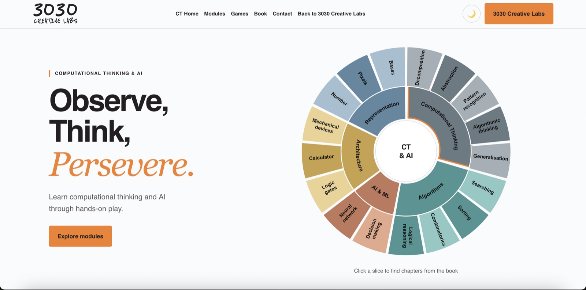
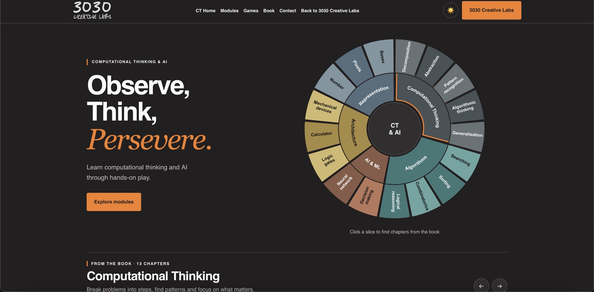
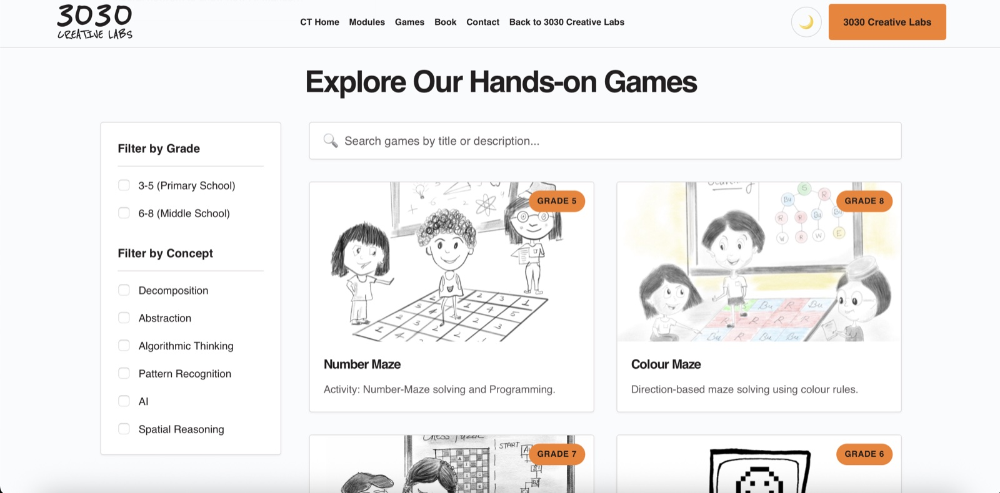
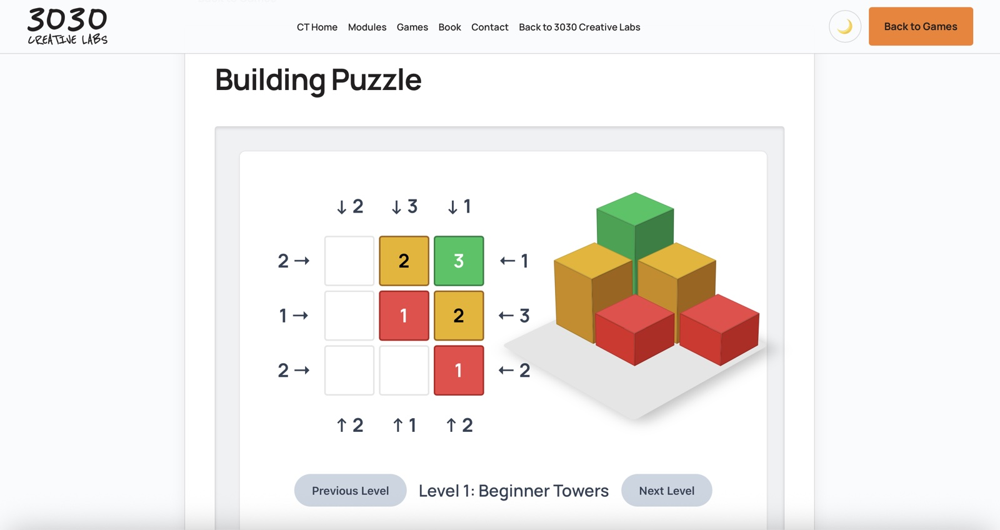
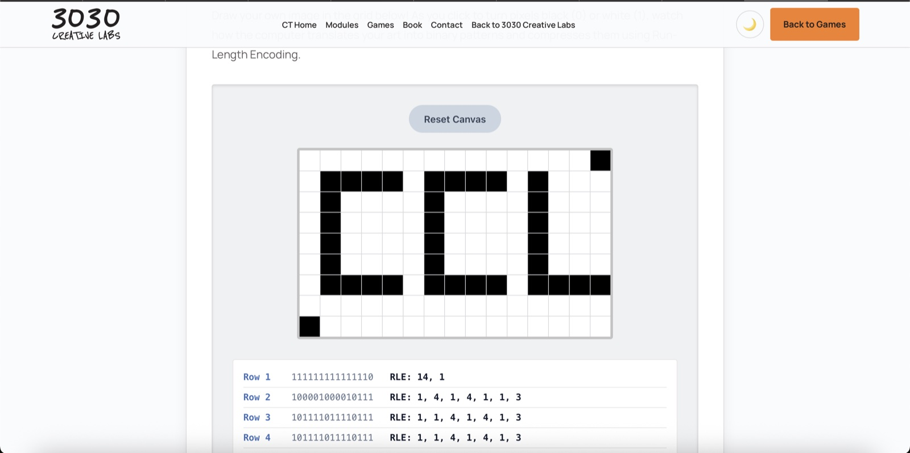
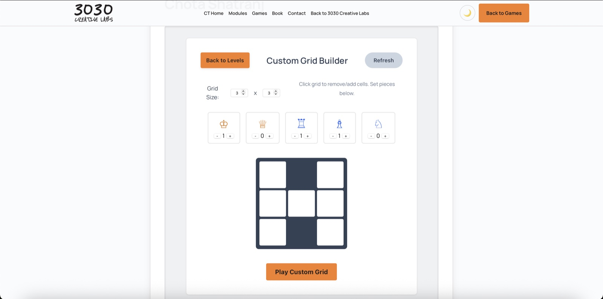

<div align="center">


# CT at CCL

### Computational Thinking & AI, learned through play

*Observe, Think, Persevere*

An interactive learning platform from the **Centre for Creative Learning (CCL), IIT Gandhinagar** and **3030 Creative Labs**, with video modules, hands-on puzzle games and a chapter-by-chapter activity book for students in Grades 4–8.

[](https://ct.3030labs.in)
[](https://3030labs.in/)


<br><br>



</div>

---

## 📑 Table of Contents

- [Overview](#-overview)
- [Features](#-features)
- [Screenshots](#-screenshots)
- [Tech Stack](#-tech-stack)
- [Project Structure](#-project-structure)
- [Getting Started](#-getting-started)
- [Routes & API Reference](#-routes--api-reference)
  - [Page Routes](#page-routes)
  - [Data APIs](#data-apis-client-side)
  - [Browser Storage](#browser-storage)
  - [External Services](#external-services)
- [Adding Content](#-adding-content)
- [Design System](#-design-system)
- [Deployment](#-deployment)
- [Contact](#-contact)

---

## 🌟 Overview

**CT at CCL** teaches the core ideas of computational thinking: **algorithmic thinking, abstraction, decomposition, pattern recognition and generalisation**. It uses puzzles, mazes, ciphers and simple AI experiments that students can play with in the browser.

| 📺 Modules | 🎮 Games | 📖 Book |
|:---:|:---:|:---:|
| **23** video lessons | **8** interactive games | **30** chapters in **7** sections |
| From *Chess, King & Sage* to *AI & Ethics* | Mazes, magic tricks, puzzles | Each chapter has a downloadable PDF |

---

## ✨ Features

- 🎥 **Video modules**: YouTube lessons with thumbnails, descriptions and a dedicated player page
- 🧩 **Playable games**: Number Maze, Colour Maze, Chess Maze, Image by Number, Parity Magic Trick, Chota Shatranj, Building Puzzle and Jug Puzzle, all rendered in the browser
- 🤖 **Auto-solve with explanations**: games show the algorithm behind the solution (for example, Breadth-First Search for the shortest maze path)
- 📚 **Learn tabs on every game**: *The Maths*, *Think About It* prompts, a quiz with explanations, and related videos
- 📈 **Progress tracking**: quiz progress is saved in the browser with no sign-up
- 📖 **Activity book**: 30 chapters with thumbnails, full content and PDF downloads
- 🌗 **Light & dark themes**: the choice is saved between visits
- 📱 **Responsive & accessible**: keyboard-operable mobile menu, visible focus states and `prefers-reduced-motion` support
- 🎯 **Concept wheel**: an interactive SVG wheel on the home page; click a slice to find the book chapters on that concept

---

## 📸 Screenshots

<table>
  <tr>
    <td width="50%" align="center">
      <br>
      <sub><b>Home (light)</b>: the CT & AI concept wheel</sub>
    </td>
    <td width="50%" align="center">
      <br>
      <sub><b>Home (dark)</b>: the same page in dark mode</sub>
    </td>
  </tr>
  <tr>
    <td colspan="2" align="center">
      <br>
      <sub><b>Games catalogue</b>: search and filter by grade and computational-thinking concept</sub>
    </td>
  </tr>
  <tr>
    <td width="50%" align="center">
      <br>
      <sub><b>Building Puzzle</b>: skyline clues with a live 3D tower view</sub>
    </td>
    <td width="50%" align="center">
      <br>
      <sub><b>Image by Number</b>: draw pixels and see the binary and run-length encoding</sub>
    </td>
  </tr>
  <tr>
    <td colspan="2" align="center">
      <br>
      <sub><b>Chota Shatranj</b>: build your own chess-piece puzzle grid</sub>
    </td>
  </tr>
</table>

---

## 🛠 Tech Stack

| Layer | Technology | Notes |
|---|---|---|
| **Markup** | HTML5 | Five static pages, semantic landmarks, ARIA attributes |
| **Styling** | CSS3 | Custom properties (design tokens), Flexbox, Grid, media queries |
| **Logic** | Vanilla JavaScript (ES6+) | No frameworks; DOM rendering, game engines, BFS solvers |
| **Graphics** | Inline SVG + PNG | SVG hero chart and game boards, PNG thumbnails |
| **Typography** | Google Fonts | **Manrope** (UI and body), **Playfair Display** (hero phrase) |
| **Video** | YouTube Embed | Privacy-friendly embeds with `rel=0` |
| **Persistence** | `localStorage` | Theme preference and learning progress |
| **Content** | JS data modules | Videos, games, learn content and book chapters stored as JS arrays and objects |
| **Hosting** | Vercel | Static hosting, no build step |

> **Zero dependencies, zero build.** Open `index.html` and it runs.

---

## 📂 Project Structure

```
CCL-Website/
├── index.html              # Home: hero, modules, games, book, contact
├── video.html              # Video player page        → ?id=videoN
├── game.html               # Interactive game page    → ?id=gameN
├── chapter.html            # Book chapter reader      → ?id=bX_Y
├── contact.html            # Contact page
│
├── app.js                  # Core app: theme, nav, rendering, game engines
├── learn.js                # Learn tabs, quizzes, progress tracking
│
├── data.js                 # videosData   – video modules
├── gameData.js             # gamesData    – game definitions
├── learnData.js            # learnData    – maths, prompts, quizzes per game
├── data/book/
│   ├── 01-maze-puzzles.js          # Maze puzzle chapters
│   ├── 02-puzzles.js               # Puzzle chapters
│   ├── 03-language-of-computer.js  # Binary, punch cards, domino computer
│   ├── 04-algorithms.js            # Sorting, searching, networks
│   ├── 05-learning-ai.js           # AI and ML chapters (P1–P6)
│   ├── 06-encryption.js            # Caesar, rotating grid, disc enigma
│   ├── 07-other-activities.js      # Golomb rulers, string art, more
│   └── index.js                    # Merges the sections into bookData
│
├── style.css               # Global styles and design tokens
├── learn.css               # Learn-tab and quiz styles
├── hero-chart.css          # Animated hero chart
│
├── img/                    # Logo and game thumbnails
├── book/                   # Chapter PDFs, thumbnails, activity images
├── docs/screenshots/       # README screenshots
└── 3030_SHARED_DESIGN_SYSTEM.md   # Shared brand and design reference
```

---

## 🚀 Getting Started

### Prerequisites
A modern web browser. Python or Node is optional and only needed to run a local server.

### Run locally

```bash
# 1. Clone the repository
git clone https://github.com/Leena2403/CCL-Website.git
cd CCL-Website

# 2. Serve the folder (pick one)
python3 -m http.server 8000
# or
npx serve .

# 3. Open in your browser
open http://localhost:8000
```

> 💡 You can also open `index.html` directly. A local server is recommended so that PDFs and YouTube embeds behave the same way they do in production.

---

## 🔌 Routes & API Reference

The site is **fully static** and has no backend server or REST API. Its "API" is made up of **URL routes with query parameters**, **global JavaScript data objects** that the renderers read, and a few **external services**.

### Page Routes

| Method | Route | Query Params | Description |
|:---:|---|---|---|
| `GET` | `/index.html` | – | Home page with modules, games, book and contact |
| `GET` | `/index.html#modules` | – | Jump to the video modules |
| `GET` | `/index.html#games` | – | Jump to the games grid |
| `GET` | `/index.html#book` | – | Jump to the book chapters |
| `GET` | `/index.html#contact` | – | Jump to the contact section |
| `GET` | `/video.html` | `id` *(required)*, e.g. `video1` | Plays a video module and shows related games |
| `GET` | `/game.html` | `id` *(required)*, e.g. `game1` | Loads an interactive game with its Learn tabs |
| `GET` | `/chapter.html` | `id` *(required)*, e.g. `b1_1` | Opens a book chapter with a PDF download |
| `GET` | `/contact.html` | – | Contact information |
| `GET` | `/book/<file>.pdf` | – | Direct PDF download for a chapter |

**Examples**

```text
/video.html?id=video2      → "02. An Obedient Idiot"
/game.html?id=game1        → Number Maze
/chapter.html?id=b1_1      → Number Maze chapter (Book §1)
```

### Data APIs (client-side)

Content is defined in JS files as global constants. To add or edit content, change these files. No other code changes are needed.

#### `videosData` · `data.js`

```js
{
  id: "video1",                         // used in video.html?id=
  title: "01. Chess - King - Sage | CCL IITGn",
  thumbnail: "book/CCL_Thumbnails_All/01_chess_king_sage.png", // optional
  youtubeId: "nMAVCu15vGw",             // YouTube video ID
  description: "Explore the fascinating story of ...",
  module: "CT and AI ML"
}
```

#### `gamesData` · `gameData.js`

```js
{
  id: "game1",                          // used in game.html?id=
  title: "Number Maze",
  grade: "Grade 5",
  concepts: ["algorithmic-thinking", "abstraction"],
  thumbnail: "img/number_maze.png",
  shortDescription: "Activity: Number-Maze solving and Programming.",
  content: `<p>...</p><div id="number-maze-1" class="interactive-game-wrapper"></div>`
}
```

> The `interactive-game-wrapper` elements are mount points. `app.js` finds them by `id` and renders the playable game inside each one.

#### `learnData` · `learnData.js`

Keyed by game ID. Powers the Learn tabs on `game.html`.

```js
learnData.game1 = {
  maths: `<h3>A maze is really a graph</h3> ...`,          // "The Maths" tab (HTML)
  think: [{ q: "Question?", a: "Revealed answer." }],       // "Think About It" prompts
  quiz:  [{ q: "...", options: ["A","B","C","D"],
            answer: 0, explain: "Why A is correct." }],     // answer = index of correct option
  videos: [{ id: "video2", why: "How it connects." }]       // related videos (IDs from data.js)
}
```

#### `bookData` · `data/book/*.js` → `data/book/index.js`

```js
{
  id: "b1_1",                           // used in chapter.html?id=
  section: "Computational Thinking Over Maze Puzzle(s)",
  title: "Number Maze",
  thumbnail: "book/chapter_thumbnails/number maze.png",
  pdfLink: "book/Number Maze Grade 5.pdf",
  content: `<div class="page-content">...</div>`
}
```

| Section file | Export | Chapters |
|---|---|:---:|
| `01-maze-puzzles.js` | `bookMazePuzzles` | 4 |
| `02-puzzles.js` | `bookPuzzles` | 2 |
| `03-language-of-computer.js` | `bookLanguageOfComputer` | 6 |
| `04-algorithms.js` | `bookAlgorithms` | 4 |
| `05-learning-ai.js` | `bookLearningAI` | 6 |
| `06-encryption.js` | `bookEncryption` | 4 |
| `07-other-activities.js` | `bookOtherActivities` | 4 |

### Browser Storage

| Key | Storage | Value | Purpose |
|---|---|---|---|
| `theme` | `localStorage` | `"light"` \| `"dark"` | Remembers the chosen colour theme |
| `ccl-progress` | `localStorage` | JSON object | Quiz and learning progress for each game |

### External Services

| Service | Endpoint | Used for |
|---|---|---|
| YouTube Embed | `https://www.youtube.com/embed/{youtubeId}?autoplay=1&rel=0` | Video playback |
| YouTube Thumbnails | `https://img.youtube.com/vi/{youtubeId}/maxresdefault.jpg` | Fallback thumbnails (`hqdefault` / `mqdefault`) |
| Google Fonts | `https://fonts.googleapis.com/css2?family=Manrope…` | Manrope and Playfair Display |
| 3030 Creative Labs | `https://3030labs.in/` | Main site link (`CCL_MAIN_SITE_URL` in `app.js`) |

---

## ➕ Adding Content

<details>
<summary><b>🎥 Add a video module</b></summary>

1. Add an object to `videosData` in `data.js` with the next `id` (e.g. `video24`).
2. Set `youtubeId` to the ID from the YouTube URL.
3. *(Optional)* Add a custom thumbnail path. Otherwise the YouTube thumbnail is used.

</details>

<details>
<summary><b>🎮 Add a game</b></summary>

1. Add an entry to `gamesData` in `gameData.js`.
2. Add a mount point `<div id="your-game" class="interactive-game-wrapper"></div>` in `content`.
3. Implement the renderer in `app.js`.
4. Add `learnData.gameN` in `learnData.js` with the maths, think prompts, quiz and related videos.

</details>

<details>
<summary><b>📖 Add a book chapter</b></summary>

1. Put the PDF in `book/` and a thumbnail in `book/chapter_thumbnails/`.
2. Add an entry to the matching `data/book/0X-*.js` section file.
3. To add a new section, create the file, include it in `index.html` and `chapter.html`, and spread it into `bookData` in `data/book/index.js`.

</details>

---

## 🎨 Design System

The site shares a visual language with the 3030 Creative Labs main site. See [`3030_SHARED_DESIGN_SYSTEM.md`](3030_SHARED_DESIGN_SYSTEM.md) for the full reference.

| | Token | Hex |
|:---:|---|---|
| 🟠 | Orange (primary CTA) | `#F57F25` |
| 🔵 | Blue (links and focus) | `#436EB6` |
| 🟣 | Purple | `#9169AD` |
| 🟢 | Green | `#4EBA6D` |
| ⚪ | Paper | `#FAFBFC` |
| ⚫ | Ink | `#231F20` |

**Type:** Manrope 400–800 · Playfair Display italic for the hero phrase
**Shape:** ~4px radius · thin borders · subtle shadows · 48px+ touch targets

---

## ☁️ Deployment

The site is deployed on **Vercel** as a static site.

```bash
npm i -g vercel
vercel --prod
```

Leave the framework preset as **Other** and leave the build command empty. The output directory is the project root.

It can also be hosted on any static host, such as GitHub Pages, Netlify or Cloudflare Pages.

---

## 📬 Contact

**Centre for Creative Learning, IIT Gandhinagar**
📧 [ccl@iitgn.ac.in](mailto:ccl@iitgn.ac.in) · 🌐 [3030labs.in](https://3030labs.in/)

<div align="center">

---

Made with 🧡 for curious minds · **Learning through play**

</div>
